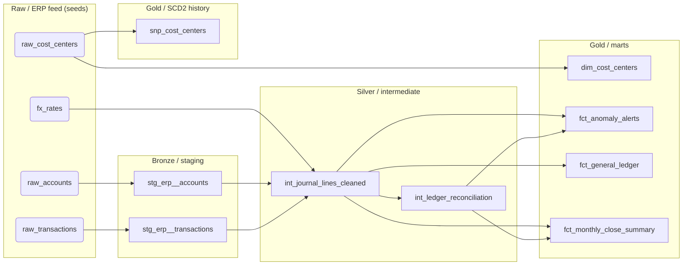

# Lineage

Generated by `python scripts/build_lineage.py` from `target/manifest.json`, so this
graph is the graph dbt built - it cannot drift from the models that exist.

## Node inventory

| Node | Layer | Materialisation | Schema | Column tests |
|---|---|---|---|---|
| `dim_cost_centers` | gold | table | `main_gold` | 2 |
| `fct_anomaly_alerts` | gold | table | `main_gold` | 1 |
| `fct_general_ledger` | gold | incremental | `main_gold` | 2 |
| `fct_monthly_close_summary` | gold | table | `main_gold` | 3 |
| `fx_rates` | raw | seed | `main_raw` | 1 |
| `raw_accounts` | raw | seed | `main_raw` | 0 |
| `raw_cost_centers` | raw | seed | `main_raw` | 0 |
| `raw_transactions` | raw | seed | `main_raw` | 0 |
| `snp_cost_centers` | scd2 | snapshot | `main_gold_scd` | 1 |
| `int_journal_lines_cleaned` | silver | view | `main_silver` | 4 |
| `int_ledger_reconciliation` | silver | view | `main_silver` | 3 |
| `stg_erp__accounts` | staging | view | `main_bronze` | 3 |
| `stg_erp__transactions` | staging | view | `main_bronze` | 9 |

## Controls as tested assertions

| Test | Kind | Severity | What failing means |
|---|---|---|---|
| `assert_debits_equals_credits` | custom | warn | A journal does not balance - FC-01 break |
| `assert_no_orphan_accounts` | custom | warn | A line references an account outside the chart - FC-02 |
| `assert_no_negative_amounts` | custom | warn | Sign convention broken in the extract |
| `assert_no_missing_fx_rate` | custom | error | USD figures would be silently wrong - FC-05 |
| `unique_current_version` | generic | error | SCD2 history has two live versions of one cost centre |

The warn-severity tests are configured to warn on purpose: during a close they are the
exception report Finance works from, and `fct_monthly_close_summary.close_status` is the
gate that blocks sign-off while rows remain.
