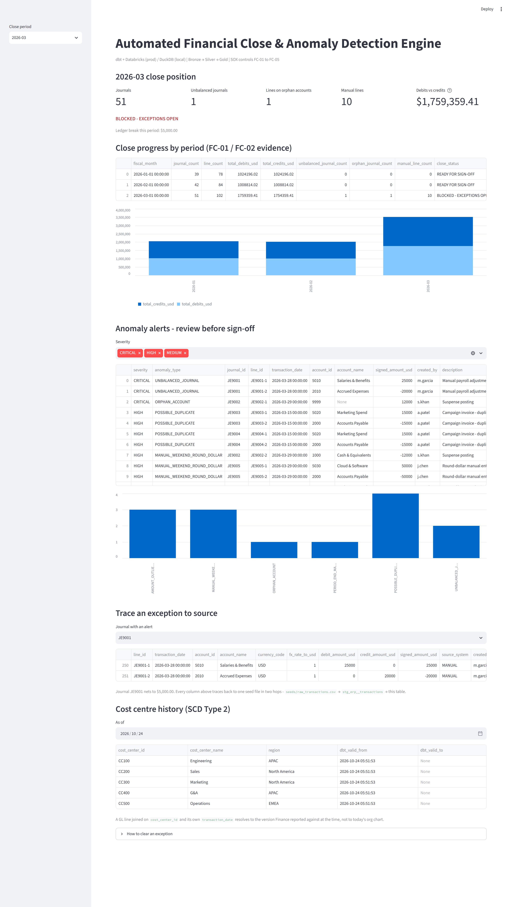
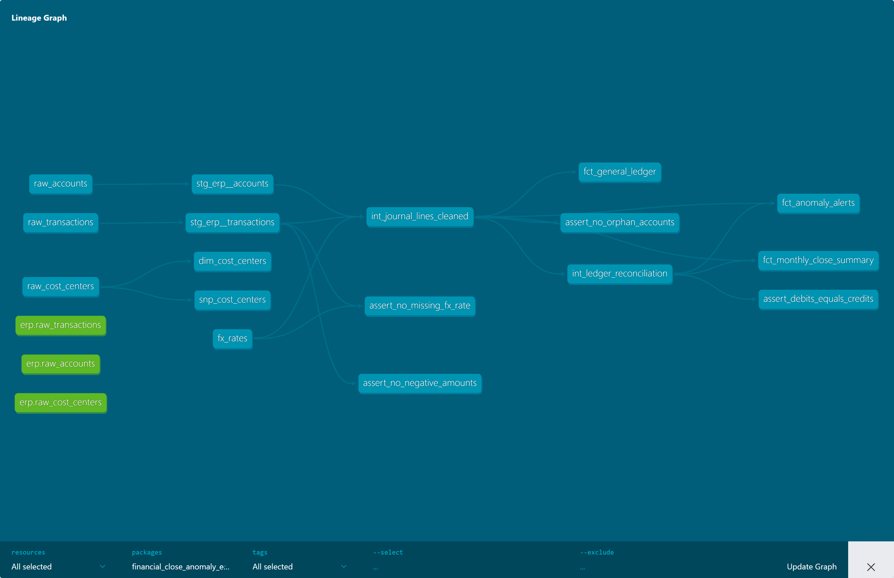

# Automated Financial Close & Anomaly Detection Engine

**Stack:** dbt Core 1.12 • DuckDB (local, verified) • Databricks / Delta Lake (prod target, configured) • Great Expectations • Streamlit

A finance-grade analytics engineering project that automates the month-end close: every
journal must balance, every account must exist in the chart of accounts, every FX rate must
resolve, and every unusual entry must be flagged *before* a controller signs off. Built to
the standard an IPO audit (SOX) would test - controls are code, evidence is a table, and no
Gold number can be edited by hand.



Everything quoted below is reproduced by the CI pipeline on every push, from a clean
checkout, with no cloud account:
[](https://github.com/Lifewitdata/financial-close-anomaly-engine/actions/workflows/ci.yml)

## Architecture (medallion)

```
ERP extract (CSV locally / Delta Bronze in prod)
  -> seeds: raw_transactions, raw_accounts, raw_cost_centers, fx_rates
  -> Bronze  models/staging/       stg_erp__transactions, stg_erp__accounts   (rename + cast only)
  -> Silver  models/intermediate/  int_journal_lines_cleaned  (FX -> USD, signed amount, anomaly flags)
                                   int_ledger_reconciliation  (per-journal debit = credit)
  -> Gold    models/marts/         fct_general_ledger (incremental merge on line_id),
                                   fct_monthly_close_summary, fct_anomaly_alerts,
                                   dim_cost_centers
  -> Gold    snapshots/            snp_cost_centers -> dim_cost_centers_history (SCD Type 2)
  -> Streamlit app.py              close position, alerts, drill-to-source, as-of history
```



[`LINEAGE.md`](LINEAGE.md) holds the same graph as Mermaid (renders on GitHub) and is
regenerated from `target/manifest.json` by `python scripts/build_lineage.py`. CI rebuilds
it and fails if the committed file no longer matches the models, so the picture cannot go
stale.

**Databricks:** `profiles.yml` ships a `databricks` target (catalog `finance_catalog`,
Delta). The model SQL is identical on both engines; the only fork is materialisation
clauses (`partition_by` / `cluster_by` under the Databricks target) and the `erp()` macro,
which resolves the three declared sources to Delta tables in prod and to dbt seeds locally.

## Controls

| Control | Implementation | Evidence |
|---|---|---|
| FC-01 Debits = credits | `tests/assert_debits_equals_credits.sql` (warn) + `int_ledger_reconciliation.is_unbalanced` | `fct_monthly_close_summary.unbalanced_journal_count` |
| FC-02 No orphan accounts | `tests/assert_no_orphan_accounts.sql` (warn) + `is_orphan_account` flag; rows retained, never dropped | `fct_anomaly_alerts` where `anomaly_type = 'ORPHAN_ACCOUNT'` |
| FC-03 Schema / DQ gates | 24 dbt generic tests (not_null, unique, accepted_values, plus the SCD2 one-open-version test) + 13-expectation Great Expectations checkpoint | `dbt build` report, `reports/gx_validation.json` |
| FC-04 Anomaly review | 6 rule + statistical detectors with severity and an owner action | `fct_anomaly_alerts` |
| FC-05 FX completeness | `tests/assert_no_missing_fx_rate.sql` (**error** - an unpriced currency stops the build, it does not warn) | `dbt build` exit code |
| SCD2 integrity | `tests/generic/unique_current_version.sql` on the snapshot | exactly one open `dbt_valid_to` per cost centre |

## Anomaly detectors in `fct_anomaly_alerts`

1. **UNBALANCED_JOURNAL** (CRITICAL) - journal debits != credits
2. **ORPHAN_ACCOUNT** (CRITICAL) - account not in the chart of accounts
3. **MANUAL_WEEKEND_ROUND_DOLLAR** (HIGH) - manual + weekend + round $1,000 multiple: the classic fraud-risk pattern
4. **POSSIBLE_DUPLICATE** (HIGH) - same date + account + USD amount + description on more than one line
5. **AMOUNT_OUTLIER_3SIGMA** (HIGH) - amount beyond mean +/- 3σ for that account
6. **PERIOD_END_MANUAL_LARGE** (MEDIUM) - large manual entry booked on the last day of the period

## Sample data and planted exceptions

`seeds/raw_transactions.csv`: 264 journal lines, 132 journals, Jan-Mar 2026, USD/EUR/GBP.
Six exception patterns are planted on purpose across `JE9001`-`JE9007` so every detector has
something to find: a $5,000 imbalance (JE9001), orphan account `9999` (JE9002), a duplicated
invoice pair (JE9003/JE9004), a $50,000 round-dollar manual entry booked on Sunday
2026-03-29 (JE9005), a $485,000 outlier (JE9006) and a $220,000 period-end manual revenue
entry (JE9007). Every other journal balances.

## Run it

```bash
pip install -r requirements.txt

dbt build --profiles-dir .                        # seeds -> bronze -> silver -> gold -> tests
streamlit run app.py                              # http://localhost:8501
python expectations/gx_suite_journal_lines.py     # GX checkpoint, exits non-zero on drift
python -m pytest tests/python -q                  # dashboard tests via Streamlit's AppTest

python scripts/build_lineage.py                   # regenerate LINEAGE.md from the manifest
python scripts/verify_close.py                    # 39 checks: every published figure vs the warehouse
python scripts/verify_prod_patterns.py            # prove incremental merge + SCD2 in a temp copy
dbt docs generate --static --profiles-dir .       # self-contained target/static_index.html

pip install -r requirements-dev.txt               # only for the screenshots:
python scripts/capture_dashboard.py               #   docs/dashboard.png
python scripts/capture_dbt_docs.py                #   docs/dbt-lineage.png
```

`profiles.yml` is read with `--profiles-dir .`, so nothing has to be copied into `~/.dbt`.
Databricks: export `DATABRICKS_HOST`, `DATABRICKS_HTTP_PATH`, `DATABRICKS_TOKEN`, install
`requirements-databricks.txt`, then `dbt build --target databricks`.

## Design decisions

- **Bronze does no business logic.** Rename and cast only, so an auditor traces any Gold
  number to a source line in two hops - the dashboard shows that trace as a caption.
- **Orphan rows are flagged, never dropped.** Dropping them would make debits "balance" by
  hiding the problem, which is the opposite of a control.
- **The dashboard never recomputes a control in pandas.** It reads Gold tables. If they are
  not built it says so, shows the raw feed and stops - a dashboard that quietly disagrees
  with the warehouse is worse than one that refuses to render.
- **Audit tests are `severity: warn`, the close summary is the gate.** Warnings list what
  Finance must clear; `close_status = 'BLOCKED - EXCEPTIONS OPEN'` is what stops sign-off.
  A control firing is not a broken pipeline. FC-05 is `error`, because an unpriced currency
  is not something to sign off around.
- **FX lives in one macro** (`macros/convert_currency.sql`) **and one versioned seed**
  (`seeds/fx_rates.csv`), not copied into five models.
- **`fct_general_ledger` is incremental on `line_id`** with a merge and an open-period
  watermark: closed months are frozen, the current month is re-merged so late-arriving
  corrections land. `partition_by` / `cluster_by` apply only under the Databricks target.
- **Cost centres are SCD Type 2** via `snapshots/snp_cost_centers.sql`, so a GL line joined
  on `cost_center_id` and its own `transaction_date` resolves to the version Finance
  reported against, not today's org chart.
- **Proofs run in a throwaway copy of the repo** (`scripts/verify_prod_patterns.py`), so
  demonstrating a merge or an org change never mutates the committed warehouse or seeds.

## What is verified, and where the evidence lives

| Claim | Reproduced by | Committed evidence |
|---|---|---|
| Build tallies and every figure in `fct_monthly_close_summary` | `scripts/verify_close.py` (39/39) | `reports/close_metrics.json` |
| GX agrees with dbt on the same three controls, same row counts | `expectations/gx_suite_journal_lines.py` | `reports/gx_validation.json` |
| Incremental merge inserts, updates in place and leaves closed months alone | `scripts/verify_prod_patterns.py` (9/9) | `reports/incremental_and_scd2_proof.json` |
| SCD2 closes old versions, keeps one active, ignores an identical reload | same script (6/6) | `reports/scd2_history.csv` |
| Dashboard renders the Gold tables with the right KPIs | `tests/python/test_dashboard.py` (6 tests), `scripts/capture_dashboard.py` | `docs/dashboard.png`, `reports/streamlit_launch.json` |
| Lineage matches the models that exist | `scripts/build_lineage.py`, CI `git diff --exit-code` | `LINEAGE.md`, `docs/dbt-lineage.png` |

## Verified build (DuckDB mirror, Python 3.11)

```
dbt build  ->  PASS=39  WARN=2  ERROR=0  SKIP=0  TOTAL=41
  (26 data tests passed, 13 nodes built, 2 control warnings)
  WARN assert_debits_equals_credits   JE9001  imbalance $5,000.00
  WARN assert_no_orphan_accounts      JE9002-1  account 9999
  -> the warnings are the planted anomalies firing, by design.

fct_monthly_close_summary
  2026-01   39 journals    78 lines   debits $1,024,196.02   credits $1,024,196.02   READY FOR SIGN-OFF
  2026-02   42 journals    84 lines   debits $1,008,814.02   credits $1,008,814.02   READY FOR SIGN-OFF
  2026-03   51 journals   102 lines   debits $1,759,359.41   credits $1,754,359.41   BLOCKED - EXCEPTIONS OPEN

fct_anomaly_alerts    14 rows, 6/6 detector types, CRITICAL 3 / HIGH 10 / MEDIUM 1
fct_general_ledger   264 rows, 264 distinct line_ids, net +$5,000.00 (the JE9001 break)
dim_cost_centers_history  5 versions, 5 active

great_expectations   verdict PASS - 13/13 structural, controls fired 1 / 1 / 4 rows
verify_close         39/39 checks
verify_prod_patterns incremental_merge 9/9, scd2_snapshot 6/6
pytest tests/python  6 passed
```

## Honest limits

- **Synthetic data only.** 264 generated journal lines, no real ledger, no PII.
- **DuckDB-verified, Databricks-ready.** The Databricks target, the incremental merge
  clauses and the Delta source resolution are configured and exercised by the same model
  SQL, but no live Databricks run is recorded here. The merge and snapshot behaviour is
  proven on DuckDB by `scripts/verify_prod_patterns.py`.
- **Great Expectations runs as an ephemeral context**, not GX Cloud / a Data Docs site.
  It is a real checkpoint with a stored result, not a config stub.
- **The 3σ detector is a rule, not a model.** On 264 lines a per-account z-score is enough;
  a real ledger needs seasonality and vendor-level baselines before you would trust more.
